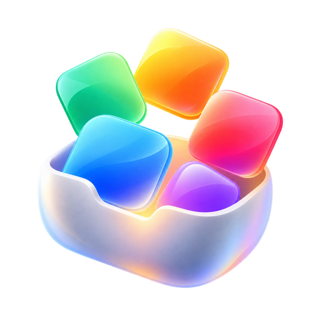
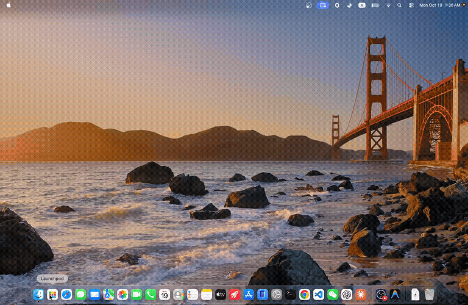

<div align="center">
  
  <h1>Launchpod</h1>
  <p><strong>熟悉的启动台，回到你的 Mac。</strong></p>
  <p>适用于 macOS 26 和 macOS 27 的免费开源启动台替代品。</p>
  <p>
    <a href="https://github.com/callumhxu/launchpod/releases/latest"></a>
    <a href="https://github.com/callumhxu/launchpod/releases"></a>
    
    <a href="LICENSE"></a>
  </p>
  <p><a href="README.md">English</a> | <a href="README.zh-Hans.md">简体中文</a></p>
</div>

Launchpod 带回你熟悉的全屏 App 网格。按页面和文件夹整理 App，一眼找到想用的，或者输入名字快速搜索。它是用 Swift、AppKit 和 Core Animation 开发的原生 Mac App，打开迅速、动画流畅，用起来就像系统自带的一样。



[查看 MP4 演示](assets/launchpod-demo.mp4)

**[下载最新版本](https://github.com/callumhxu/launchpod/releases/latest)**

## 功能

- **熟悉的网格。** 工作和日常 App 都在经典模式的全屏分页网格里。
- **文件夹和页面。** 把相关 App 放进同一个文件夹，拖放即可随意调整位置。
- **搜索。** 在启动器里直接按名字找到 App，布局保持原样。
- **按你的习惯来。** 调整图标网格，添加 App 目录，选择外观和 App 图标。
- **随时打开。** 从程序坞、菜单栏或全局快捷键打开 Launchpod。
- **布局备份。** 在“高级”设置里导出、导入和恢复你的布局。
- **八种语言。** 英文、简体中文、繁体中文、法文、德文、日文、韩文和西班牙文，可以在设置里单独选择，不受系统语言限制。
- **免费开源。** 不订阅、不注册、没有试用期，以 GPL-3.0 许可证发布。
- **自动更新。** 通过 [Sparkle](https://sparkle-project.org) 推送经过签名的更新。

## 常见问题

**Launchpod 和聚焦搜索有什么区别？**
聚焦搜索用来搜索整台 Mac。Launchpod 给你的 App 一个专属网格，可以浏览，也可以按页面和文件夹整理。两者可以一起用。

**支持哪些 macOS 版本？**
macOS 26 及更高版本，包括 macOS 27。

**真的免费吗？**
是的。Launchpod 免费、开源，以 GPL-3.0 许可证发布。

## 隐私

Launchpod 不收集任何数据，也不需要账号。它唯一的网络连接是 Sparkle 的更新检查。设置 › 关于里的链接会在浏览器中打开。

## 系统要求

- macOS 26 或更高版本
- Apple 芯片或 Intel 芯片（通用版本）

## 安装

用 [Homebrew](https://brew.sh) 安装：

```sh
brew install --cask callumhxu/tap/launchpod
```

或者从 [Releases](https://github.com/callumhxu/launchpod/releases) 下载最新的 `Launchpod-<版本号>-universal.dmg`，打开后把 Launchpod 拖到“应用程序”文件夹。正式版本使用 Developer ID 签名，并经过 Apple 公证。

第一次在 Launchpod 里删除 App 时，macOS 会请求允许 Launchpod 控制访达，由访达把 App 移到废纸篓。

## 从源码编译

1. 安装 Xcode 27 或更高版本。
2. 克隆仓库：

   ```sh
   git clone https://github.com/callumhxu/launchpod.git
   ```

3. 打开 `apps/macOS/Launchpod.xcodeproj`，选择 `Launchpod` scheme 并运行。Xcode 会自动获取 Sparkle 依赖。

本地编译没有配置更新源，所以“检查更新”不可用。如果要用自己的开发者团队签名，在 target 的 Signing & Capabilities 里设置。

### 运行测试

单元测试需要 macOS 27 或更高版本：

```sh
xcodebuild test -project apps/macOS/Launchpod.xcodeproj -scheme Launchpod
```

有些测试需要打开原生窗口，当前会话无法显示窗口时会自动跳过。

## 目录结构

| 路径 | 内容 |
| --- | --- |
| `apps/macOS/Launchpod` | App 源码：经典模式、设置、引导、共享领域模型和系统集成 |
| `apps/macOS/Extensions` | 程序坞图标插件 |
| `apps/macOS/LaunchpodTests` | 单元测试，目录与源码一一对应 |
| `apps/macOS/LaunchpodUITests` | UI 测试 |
| `scripts` | 发布构建脚本、发布设置和 Homebrew cask 模板 |
| `.github/workflows` | 推送版本 tag 时签名、公证并发布；PR 上的 CLA 签署 |

## 参与贡献

欢迎贡献。请先阅读 [贡献指南](CONTRIBUTING.zh-Hans.md)；每位贡献者需要在 PR 中签署一次[贡献者许可协议](CLA.zh-Hans.md)。

## 许可证

Launchpod 以 [GNU 通用公共许可证 v3.0](LICENSE) 发布。

## 免责声明

Launchpod 是由 Callum Xu 个人开发的独立开源项目，与 Apple Inc. 没有关联。

Apple、Mac、macOS 和 Launchpad（启动台）是 Apple Inc. 的商标。GitHub、X、YouTube、TikTok 以及本文提到的其他名称和 logo 归各自所有者所有。

Launchpod 免费提供，不对软件的可用性或适用性作任何保证；因使用本软件产生的问题，作者不承担责任。详见[许可证](LICENSE)。

## 链接

- GitHub：[callumhxu/launchpod](https://github.com/callumhxu/launchpod)
- X：[@callumhxu](https://x.com/callumhxu)
- YouTube：[@callumhxu](https://www.youtube.com/@callumhxu)
- TikTok：[@callumhxu](https://www.tiktok.com/@callumhxu)
